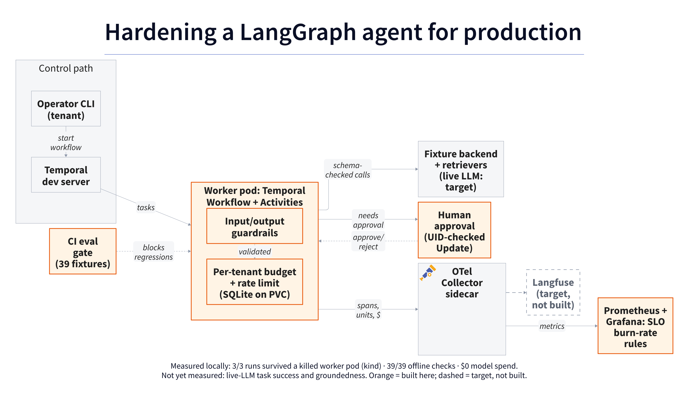

# agent-hardening-kit

[](https://github.com/H-Nizami/agent-hardening-kit/actions/workflows/ci.yml)

> **Result:** **3/3** runs survived a killed worker pod (local kind) · **39/39** offline checks · **$0** model spend · Not yet measured: live-LLM task success, groundedness, p95 latency, $/task.

An executable LangGraph hardening lab: tenant-scoped retrieval, strict input/output
and tool contracts, synthetic PII redaction, atomic per-tenant admission limits,
durable Temporal Activities with authorized human approval, sanitized OpenTelemetry,
and a Helm chart proven by a pod-kill test on a disposable kind cluster.
The backend is deterministic and local. It makes no model, search or cloud calls
and explicitly disables inherited LangSmith tracing during graph execution.



Evidence: [offline fixtures](eval/results/latest.md) ·
[local Temporal recovery](evidence/runtime/latest.md) ·
[Collector roundtrip](evidence/telemetry/latest.md) ·
[kind pod-kill recovery](evidence/cluster/latest.md).
Try it: [short demo](docs/demo.md) · [operator runbook](docs/runbook.md).

## Quickstart

Requires Python 3.12 and pip. Dependency installation needs internet; the demo and
evaluation run offline without credentials, Docker, a cluster or a model service.

```bash
python3.12 -m venv .venv
.venv/bin/python -m pip install --require-hashes -r requirements-dev.lock
.venv/bin/python -m pip install --no-build-isolation --no-deps .
make demo
make test eval
```

The demo answers an Acme authentication question with a tenant-visible citation.
To ask a Beta question, use the installed CLI:

```bash
.venv/bin/python -m agent_hardening_kit demo --tenant beta --question 'What is the refund policy?'
.venv/bin/python -m agent_hardening_kit eval --out .cache/eval
```

`demo` keeps reservations and cached answers in `.cache/demo.sqlite`. Each default
request ID is new; passing the same `--request-id` replays a settled answer without
another backend call. A conflicting request under that identity is blocked.
Evaluation cases use isolated temporary databases in each mode.

For diagram and workflow checks, install shellcheck and the pinned binaries:

```bash
make tools
make lint test eval diagram
```

For the Temporal, telemetry and kind paths, install the pinned runtime binaries.
`make chaos` also needs Docker. The recorded local passing run used Docker Desktop
with 3 CPUs and 2.85 GiB of memory (`docker_resources` in the evidence).

```bash
scripts/tools.sh temporal otelcol-contrib promtool kind kubectl helm
make chart chaos
```

Dependencies and their hashes are exported from `uv.lock` into
`requirements-dev.lock`. Maintainers can use `uv sync --locked --extra dev` for
editable development, then `uv export --locked --extra dev --no-emit-project
--output-file requirements-dev.lock` after intentional dependency changes.
CI installs the hash-locked dependencies and the package, runs tests and the full
evaluation, and compares its deterministic report with committed evidence.

## T1 fixture results

The [committed evaluation](eval/results/latest.md) contains **39 fixed cases** across
two synthetic tenants. All **39/39 hardened checks pass**: 12 retrieval questions,
4 unknown-topic refusals, and 23 controls/declared fault-injection cases. The same
corpus, graph, backend and golden expectations run with the added controls off
and on. Fixtures are pinned by an independent case-ID/group manifest; deleting a
case fails the gate. Actual model spend is **$0**.

| Check | Hardened result |
|---|---|
| Retrieval recall@4, 12 retrieval cases | 1.0 |
| Extractive citation support, answered retrieval cases | 1.0 |
| Unknown-topic refusal checks | 4/4 |
| Cases sending foreign-tenant documents to the backend | 0 |
| Checks requiring zero additional backend calls | 9/9 |

The deliberately unsafe baseline sends foreign-tenant documents to its backend
in 31 cases. This measures a missing local retrieval filter, not observed data
exfiltration by a live model. Tool-schema checks remain shared by both modes;
the baseline is not an upstream tutorial benchmark. Synthetic provider faults
are reported separately from retrieval questions.

These scores demonstrate deterministic fixture/control behavior. They do not
measure LLM answer quality, semantic groundedness, production success or latency.

## Durability, approval and recovery results

Each run is a native Temporal Workflow with separate Activities for prepare,
reserve, generate, validate/settle, authorize and apply ([ADR 0004](docs/decisions/0004-native-temporal-orchestration.md)).
A run that proposes a synthetic support ticket waits for a human decision, checked
for tenant, action, approver and deadline. Approval comes through a local Unix
socket that checks the caller's user ID.

| Evidence | Result |
|---|---|
| [kind pod kill](evidence/cluster/latest.md): runs completed after the worker pod was force-deleted at `pending_approval` | 3/3 |
| Same run: worker pod deleted to replacement Ready | 7.9 s |
| Same run: histories replayed after restart (recover, reject, duplicate, expire) | 6/6 |
| Same run: synthetic tickets per approved action, including one retried lost acknowledgement | exactly 1 |
| [Localhost process kill](evidence/runtime/latest.md) (SIGKILL of the worker) | 3/3 |
| [Collector roundtrip](evidence/telemetry/latest.md): spans received, canary strings leaked | 56, 0 |

The current kind result was observed locally on a run from the committed revision it
names. An earlier uncommitted-chart run also passed. The first two attempts failed
during `helm install`: a `helm install` timeout (cause not recorded), then a
Temporal start failure (recorded as `CrashLoopBackOff`) fixed in the chart. Both
are kept in [`evidence/cluster/runs/`](evidence/cluster/runs/). The kind run is
observed recovery of one local single-node cluster, not an availability SLO.
The CI chaos job (`kind-chaos`) also passed on a GitHub Actions runner for commit `64b0e0c` ([run](https://github.com/H-Nizami/agent-hardening-kit/actions/runs/41432924927)).

## Implemented behavior

- A real `StateGraph` separates routing, source retrieval, synthesis and validation.
- Hardened retrieval filters by tenant before documents reach the backend; source
  specialists are deterministic product/support retrievers.
- Strict Pydantic contracts reject unknown fields, invalid tool arguments and
  unsupported citations. Answer text must have extractive support in retrieved
  evidence; unfamiliar topics are refused.
- Supported synthetic email, US phone and SSN forms are redacted before backend
  input and in output. Explicit fixture injection patterns are blocked.
- SQLite transactions reserve integer fixture units and micro-USD before a call,
  with per-tenant token/money caps and rate windows. Denied admissions make no call.
- Duplicate identities cannot consume a second reservation. Failed calls and
  incomplete usage reports retain their reservation. Reported usage overruns are
  recorded and freeze further admission for that tenant.

The backend derives output from documents, never from golden answers or case IDs.
Fixture units are whitespace accounting units, not provider tokenizer counts.
Nonzero money values in unit tests are synthetic. A future provider adapter must
meter usage independently; generated model text is not an accounting authority.

## Baseline credit

This local adaptation follows LangChain's MIT-licensed
[Build a multi-source knowledge base with routing](https://docs.langchain.com/oss/python/langchain/multi-agent/router-knowledge-base)
tutorial, pinned at
[`202c34b6d53c5f1a84913eacfc76409326846001`](https://github.com/langchain-ai/docs/blob/202c34b6d53c5f1a84913eacfc76409326846001/src/oss/langchain/multi-agent/router-knowledge-base.mdx).
It uses the routing architecture with local product/support documents and an
extractive fixture backend. It does not run or benchmark the upstream application.
See [ADR 0003](docs/decisions/0003-credited-offline-baseline.md) and the preserved
[MIT notice](third_party/langchain-docs-LICENSE).

## Implemented components and targets

In the cover diagram, orange boxes are built and measured in this repository,
grey boxes are existing software, and the dashed box is a target that is not built.
Diagram source: [`docs/architecture.d2`](docs/architecture.d2).

| Stage | Status |
|---|---|
| T0: repository, CI and architecture | Complete |
| T1: local graph, controls, tenant admission, fixture eval and CLI | Implemented |
| T2: Temporal Activities, durable approvals and worker recovery | Implemented, local evidence |
| T3: OTel Collector, Prometheus metrics, Grafana dashboard, SLO burn-rate rules | Implemented, local evidence |
| T3 target: Langfuse, Tempo or another remote trace store | Not built |
| T4: Helm chart, kind deployment and pod-kill recovery | Implemented; local kind run and CI chaos run passed |
| Live-model comparison (task success, groundedness, latency, $/task) | Not measured |

`make chart` lints and policy-checks the chart without a cluster. `make chaos`
runs the full kind proof and always deletes its own cluster. `make up` / `make
down` are not used; the [runbook](docs/runbook.md) lists the start, approve,
reject, recover and teardown commands. Stage scope and acceptance criteria are
summarized in [docs/design.md](docs/design.md).

## Limits

Deployment limits are listed in the [runbook](docs/runbook.md#deployment-limits)
and [deploy/README.md](deploy/README.md): one worker replica with SQLite on a
ReadWriteOnce PVC ([ADR 0005](docs/decisions/0005-single-worker-sqlite-pvc.md)),
the unauthenticated Temporal development server, ephemeral telemetry storage and
NetworkPolicy that default kindnet does not enforce. Anyone who can reach the
Temporal port directly has an infrastructure role; app approval policy does not
secure that endpoint.

Tenant identity comes from a trusted local caller. There is no HTTP API or user
authentication; a future service must bind identity to authenticated credentials.
The SQLite budget store is authoritative on one host, not a distributed quota
service. Custom Python adapters are trusted code, not sandboxed tools.

Redaction recognizes only the documented synthetic forms. Pattern-based injection
checks do not provide general injection resistance. Extractive support checks
text provenance rather than semantic truth or paraphrase quality. The small
hand-built golden set covers known regressions, not arbitrary production traffic.

## Design decisions

- [0001: Record decisions](docs/decisions/0001-record-decisions.md)
- [0002: Temporal for durable execution](docs/decisions/0002-temporal-durable-execution.md)
- [0003: Credited offline baseline](docs/decisions/0003-credited-offline-baseline.md)
- [0004: Native Temporal orchestration, not the preview LangGraph plugin](docs/decisions/0004-native-temporal-orchestration.md)
- [0005: One worker replica with SQLite on a ReadWriteOnce PVC](docs/decisions/0005-single-worker-sqlite-pvc.md)
- [Pinned versions and dependency locks](docs/pins.md)

## How I'd do this for your team

Start with real failure cases and a small golden set. Add tenant admission and
tool/output contracts, then measure each control against your existing behavior.
Next put external calls behind durable activities, add authorized approval gates,
and verify recovery before a cluster rollout. Your team owns the resulting evals,
runbooks, dashboards and acceptance evidence.

## License

Apache-2.0. See LICENSE; upstream notices are preserved in `third_party/`.
